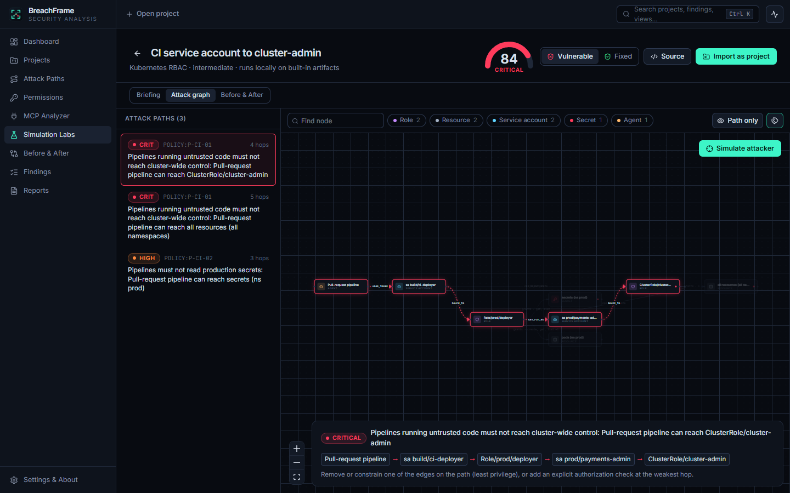
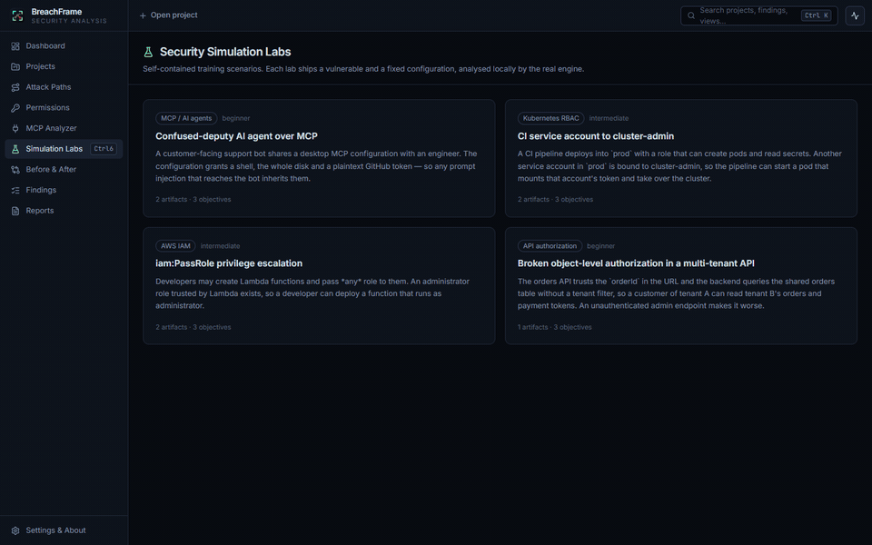

<p align="center">
  
</p>

<h1 align="center">BreachFrame</h1>

<p align="center"><b>Visualize the risk. Understand the breach.</b></p>

<p align="center">
  <a href="https://github.com/SyntaX-sudo/BreachFrame/actions/workflows/ci.yml"></a>
  <a href="LICENSE"></a>
  <a href="https://github.com/SyntaX-sudo/BreachFrame/releases"></a>
</p>

<p align="center"><a href="README.pt-BR.md">Leia em português</a></p>

BreachFrame is an open-source desktop application for **offline security
auditing** of access paths. You import configuration files: Kubernetes RBAC,
AWS IAM, MCP agent configurations, or your own environment model. BreachFrame
builds a permission graph, finds the paths that violate the policies you
declare, flags risky permissions and MCP setups, and exports reports.

It is a defensive and educational tool. **It does not scan networks, contact
hosts or exploit anything.** It only reads files you choose (or the bundled
labs), and it never executes commands found in them.



<p align="center"></p>

> Screenshots and the demo were captured from the real application on Windows
> 10 by the end-to-end test suite (`SCREENSHOTS=1 npm run test:e2e`). Linux and
> macOS screenshots have not been captured yet.

## Features

| Module | What it does |
|--------|--------------|
| **Security Dashboard** | Live totals from the local database: open findings by severity, risk score per analysis, workflow status, most frequent issues, projects, recent activity. |
| **Attack Path Visualizer** | Interactive graph of users, groups, roles, service accounts, services, APIs, AI agents, MCP servers, tools and protected resources. Lists every path that violates a deny policy, highlights it hop by hop, and supports filtering by node kind, search and "path only" mode. |
| **Permission Auditor** | Effective reach of every principal (what it can reach, how many sensitive resources, worst finding), plus RBAC, IAM and policy findings. |
| **MCP Security Analyzer** | Static analysis of MCP client configs (Claude Desktop, Claude Code, VS Code, Cursor, Windsurf, Gemini CLI). Covers hardcoded secrets (redacted), plaintext HTTP, unpinned packages, inline shells, `curl \| sh`, privileged containers, broad filesystem roots, auto-approved tools and more. It can discover config files on your machine (you choose whether to import them). **Nothing is executed or contacted.** |
| **Simulation Labs** | Four self-contained training scenarios: MCP confused deputy, Kubernetes CI escalation, AWS `iam:PassRole` escalation, multi-tenant API BOLA. Each has a briefing, an attack graph, a vulnerable and a fixed variant, and can be imported as a project. |
| **Blast-radius simulation** | Pick a start node and replay, hop by hop, what an attacker controlling it could reach in the model. Always labelled *model-based*: no real system is touched. |
| **Before & After** | Compare two analyses, or a lab's vulnerable and fixed variants: risk delta, resolved, introduced and still-present findings, and graph edges removed or added. |
| **Findings Manager** | Every finding with severity, evidence, impact and recommendation. Workflow status (open, in progress, resolved, accepted risk, false positive) and analyst notes persist across re-analyses through stable fingerprints. History mode includes findings that are no longer present. |
| **Report Generator** | Self-contained HTML report (no scripts, print-friendly, light/dark) and machine-readable JSON, including artifact SHA-256 hashes, policies, methodology, finding statuses and notes. |
| **CLI** | `breachframe analyze` runs the same engine for CI pipelines, with `--fail-on high` to break builds. |

Other details:

- Project tabs, command palette (`Ctrl/⌘ K`) and keyboard shortcuts.
- Activity panel and loading states throughout.
- All data stays in a local SQLite database.

### Supported inputs

| Input | Detection |
|-------|-----------|
| BreachFrame environment file (YAML/JSON) | `breachframe: 1`. Your own graph and deny-path policies, see [docs/environment-format.md](docs/environment-format.md) |
| Kubernetes RBAC manifests | `Role`, `ClusterRole`, `RoleBinding`, `ClusterRoleBinding`, `ServiceAccount`, `List` |
| AWS IAM | Policy documents and `aws iam get-account-authorization-details` output |
| MCP configuration | `mcpServers` / `servers` / `mcp.servers` / `projects.*.mcpServers`, JSON with comments |

All rules are listed in [docs/rules.md](docs/rules.md). Policies are evaluated over
the merged graph of all files in a project, so one policy can span environment,
RBAC, IAM and MCP nodes.

## Compatibility

Only what has actually been verified is marked as such.

| Platform | Status |
|----------|--------|
| Windows 10 x64 | ✅ Built, unit- and E2E-tested on Windows 10 Pro 22H2 (19045). NSIS and MSI installers built locally; silent per-user NSIS install, first launch and uninstall verified (the MSI was built but not install-tested). |
| Windows 11 x64 | ⚠️ Expected to work (same WebView2 runtime); not tested yet. |
| Linux x86_64: Ubuntu 22.04+ / Debian 12+ / Linux Mint 21+ | ⚠️ CI (Ubuntu 22.04) passes all Rust tests and builds AppImage, .deb and .rpm. The app has not been launched on these distros yet. |
| Linux x86_64: Fedora / Arch | ⚠️ Build dependencies documented; not validated. |
| Linux ARM64 | ⚠️ CI builds AppImage, .deb and .rpm on a GitHub ARM runner; not launched yet. |
| macOS 10.15+ Apple Silicon / Intel | ⚠️ CI (macOS, Apple Silicon) passes all Rust tests and builds DMGs for both architectures; the app has not been launched yet. **Builds are unsigned and not notarized** unless Apple credentials are configured (see [docs/releasing.md](docs/releasing.md)). |

Reports of success or failure on other platforms are very welcome. Please open
an issue.

## Download

**No release has been published yet.** Once a maintainer publishes one, the
installers and a `SHA256SUMS.txt` file will be available on the
[Releases page](https://github.com/SyntaX-sudo/BreachFrame/releases):

| OS | File |
|----|------|
| Windows | `BreachFrame_<version>_x64-setup.exe` (NSIS, per-user) or `BreachFrame_<version>_x64_en-US.msi` |
| Linux | `.AppImage`, `.deb`, `.rpm` |
| macOS | `BreachFrame_<version>_aarch64.dmg` (Apple Silicon), `_x64.dmg` (Intel) |

Until then, build from source ([docs/building.md](docs/building.md)), or download
the installers attached to a successful CI run (*Actions → CI → Artifacts*).

## Installation

**Windows**:

- Run the setup `.exe` (no administrator rights needed) or the `.msi`.
- WebView2 is downloaded automatically if it is missing.
- Unsigned builds show a SmartScreen warning: *More info → Run anyway*.
- Uninstall from *Settings → Apps*.

**Linux**:

```bash
# Debian / Ubuntu / Mint
sudo apt install ./BreachFrame_<version>_amd64.deb
# Fedora
sudo dnf install ./BreachFrame-<version>-1.x86_64.rpm
# Any distribution (needs WebKitGTK 4.1 and GTK 3 installed)
chmod +x BreachFrame_<version>_amd64.AppImage && ./BreachFrame_<version>_amd64.AppImage
```

**macOS**:

- Open the `.dmg` and drag BreachFrame to *Applications*.
- Unsigned builds are blocked by Gatekeeper on first launch. Right-click the app
  → *Open*, or run `xattr -dr com.apple.quarantine /Applications/BreachFrame.app`.

Verify a download with `sha256sum -c SHA256SUMS.txt --ignore-missing`.

Your data lives in a local SQLite database. See
[docs/architecture.md](docs/architecture.md#data-location) for its location.

## Usage

1. **Try a lab**: *Simulation Labs → CI service account to cluster-admin*.
   Open *Attack graph* and click a path, then press *Simulate attacker*. Switch
   to *Fixed* and then *Before & After*.
2. **Audit your own files**:
   - *Projects → New project* (`Ctrl+N`).
   - *Import files* (`Ctrl+I`) or paste text. On the MCP Analyzer page you can
     import MCP configs discovered on this machine.
   - *Run analysis* (`Ctrl+Enter`).
3. **Triage**: open *Findings*, set a status, add notes. Statuses survive
   re-analysis, and fixed findings are resolved automatically.
4. **Report**: *Reports → Export HTML / JSON*.

Ready-made inputs are in [`examples/`](examples). For example,
[`examples/environment/support-agent-platform.yaml`](examples/environment/support-agent-platform.yaml)
models an AI support agent whose MCP tool can reach a billing database:

```yaml
policies:
  - id: P-AGENT-01
    name: Public-facing agents must not reach the billing database
    severity: critical
    deny:
      from: { attributes: { exposure: public } }
      to: { ids: ["db:billing"] }
```

### CLI

```bash
breachframe analyze examples/*/*                       # summary
breachframe analyze k8s/*.yaml --fail-on high          # exit code 2 if high+ findings
breachframe analyze iam.json --format html --output report.html
breachframe lab k8s-ci-escalation --fixed
```

The CLI is built with `cargo build -p breachframe-cli --release`. It is not yet
shipped in the installers.

### Keyboard shortcuts

| Keys | Action |
|------|--------|
| `Ctrl/⌘ K` | Command palette / search |
| `Ctrl/⌘ 1…9` | Switch view |
| `Ctrl/⌘ N` / `I` / `Enter` | New project / import files / run analysis |
| `Ctrl/⌘ W`, `Ctrl/⌘ Shift ]` `[` | Close / cycle project tabs |
| `Ctrl/⌘ .` | Activity panel |
| `?` | Shortcut help |

## Architecture

```
React + TypeScript UI ──Tauri IPC──► Rust app layer (commands, services, SQLite)
                                          │
                                          ▼
                     breachframe-engine (pure Rust: parse → graph → rules →
                     policies → score → simulate/compare → HTML/JSON report)
                                          ▲
                                breachframe CLI
```

- Stack: Tauri 2, Rust, React 19, TypeScript, Tailwind CSS 4, React Flow, SQLite
  (bundled), Vitest, Playwright.
- No Python and no runtime downloads.
- The engine has no filesystem, network or process access.

See [docs/architecture.md](docs/architecture.md) for details.

### Tests

| Suite | Command | Coverage |
|-------|---------|----------|
| Engine unit + integration | `cargo test --workspace` | parsers, input limits, every rule, policy BFS, secrets, risk score, simulation, comparison, reports, labs, examples, app services (SQLite lifecycle) |
| Front end | `npm test` | graph helpers, IPC contract (mocked Tauri IPC), shortcuts, UI components |
| Desktop E2E | `npm run test:e2e` | the real Windows app over WebView2 DevTools: labs, simulation, project import, MCP view, findings workflow, reports, palette |

## Security

- [SECURITY.md](SECURITY.md) explains how to report vulnerabilities privately.
- The app enforces a strict Content Security Policy.
- Report previews run in a sandboxed iframe without scripts.
- Inputs are size-, depth- and type-limited.
- YAML alias bombs are rejected.
- Credentials are redacted before storage.

## Contributing

See [CONTRIBUTING.md](CONTRIBUTING.md). Releases follow
[docs/releasing.md](docs/releasing.md). They are draft-only and require
maintainer approval.

## Roadmap

Not implemented yet:

- [ ] Validate and publish signed installers for Windows and macOS
- [ ] Linux/macOS screenshots and validation on each listed distribution
- [ ] Ship the CLI inside the installers
- [ ] More importers: Azure RBAC, GCP IAM, Terraform plans, Kubernetes `Pod` /
      workload specs, OpenAPI security schemes
- [ ] SARIF export for code-scanning integrations
- [ ] Graph export (PNG/SVG) from the visualizer
- [ ] Custom rule packs
- [ ] UI localisation (the app UI is English-only today)

## License

[MIT](LICENSE) © BreachFrame contributors
