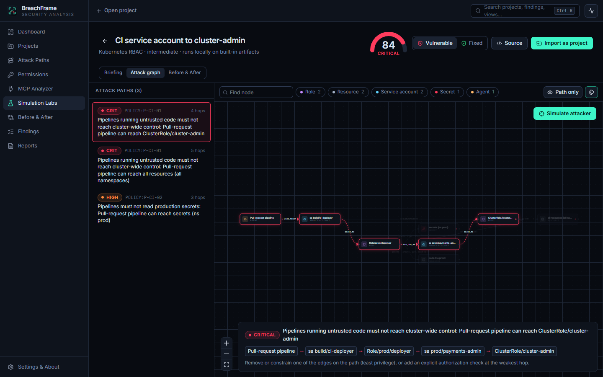
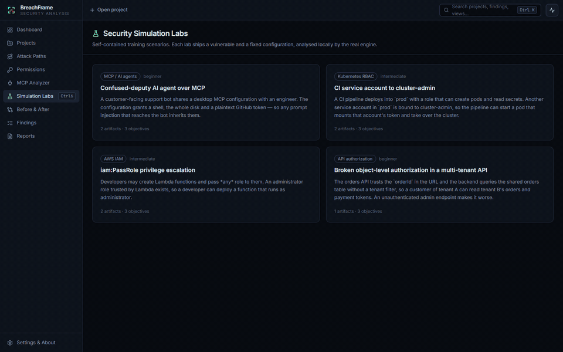

<p align="center">
  
</p>

<h1 align="center">BreachFrame</h1>

<p align="center"><b>Visualize the risk. Understand the breach.</b></p>

<p align="center">
  <a href="https://github.com/SyntaX-sudo/BreachFrame/actions/workflows/ci.yml"></a>
  <a href="LICENSE"></a>
  <a href="https://github.com/SyntaX-sudo/BreachFrame/releases"></a>
</p>

<p align="center"><a href="README.md">Read in English</a></p>

O BreachFrame é um aplicativo desktop de código aberto para **auditoria de
segurança offline** de caminhos de acesso. Você importa arquivos de
configuração: Kubernetes RBAC, AWS IAM, configurações de agentes MCP ou o seu
próprio modelo de ambiente. O BreachFrame monta um grafo de permissões, encontra
os caminhos que violam as políticas que você declarou, aponta permissões e
configurações MCP arriscadas e exporta relatórios.

É uma ferramenta defensiva e educacional. **Ela não faz varredura de redes, não
contata hosts e não explora nada.** Ela lê apenas os arquivos que você escolhe
(ou os laboratórios embutidos) e nunca executa comandos contidos neles.



<p align="center"></p>

> As capturas de tela e a demonstração foram geradas a partir do aplicativo real
> no Windows 10 pela suíte de testes end-to-end (`SCREENSHOTS=1 npm run test:e2e`).
> Ainda não há capturas de Linux e macOS.

## Funcionalidades

| Módulo | O que faz |
|--------|-----------|
| **Security Dashboard** | Totais reais do banco de dados local: achados abertos por severidade, risk score por análise, status do fluxo de trabalho, problemas mais frequentes, projetos e atividade recente. |
| **Attack Path Visualizer** | Grafo interativo de usuários, grupos, papéis, service accounts, serviços, APIs, agentes de IA, servidores MCP, ferramentas e recursos protegidos. Lista todos os caminhos que violam uma política de negação, destaca cada salto e oferece filtro por tipo de nó, busca e modo "somente caminho". |
| **Permission Auditor** | Alcance efetivo de cada principal (o que alcança, quantos recursos sensíveis, pior achado), além dos achados de RBAC, IAM e políticas. |
| **MCP Security Analyzer** | Análise estática de configurações de clientes MCP (Claude Desktop, Claude Code, VS Code, Cursor, Windsurf, Gemini CLI). Cobre segredos hardcoded (mascarados), HTTP sem TLS, pacotes sem versão fixa, shells inline, `curl \| sh`, contêineres privilegiados, raízes de sistema de arquivos amplas, ferramentas auto-aprovadas e mais. Pode localizar arquivos de configuração na sua máquina (você decide se importa). **Nada é executado ou contatado.** |
| **Simulation Labs** | Quatro cenários de treino autocontidos: confused deputy em MCP, escalada em CI no Kubernetes, escalada via `iam:PassRole` na AWS e BOLA em API multi-tenant. Cada um tem briefing, grafo de ataque, variantes vulnerável e corrigida, e pode ser importado como projeto. |
| **Simulação de raio de impacto** | Escolha um nó de partida e reproduza, salto a salto, o que um atacante que o controla alcançaria no modelo. Sempre identificada como *baseada em modelo*: nenhum sistema real é tocado. |
| **Before & After** | Compara duas análises, ou as variantes vulnerável e corrigida de um laboratório: variação de risco, achados resolvidos, introduzidos e persistentes, e arestas removidas ou adicionadas no grafo. |
| **Findings Manager** | Cada achado com severidade, evidência, impacto e recomendação. O status (aberto, em andamento, resolvido, risco aceito, falso positivo) e as notas do analista persistem entre reanálises graças a fingerprints estáveis. O modo histórico inclui achados que não estão mais presentes. |
| **Report Generator** | Relatório HTML autocontido (sem scripts, pronto para impressão, claro/escuro) e JSON legível por máquina, incluindo hashes SHA-256 dos artefatos, políticas, metodologia, status e notas. |
| **CLI** | `breachframe analyze` usa o mesmo motor em pipelines de CI, com `--fail-on high` para quebrar o build. |

Outros detalhes:

- Abas de projeto, paleta de comandos (`Ctrl/⌘ K`) e atalhos de teclado.
- Painel de atividade e estados de carregamento em todas as telas.
- Todos os dados ficam em um banco SQLite local.

### Entradas suportadas

| Entrada | Detecção |
|---------|----------|
| Arquivo de ambiente BreachFrame (YAML/JSON) | `breachframe: 1`. Seu próprio grafo e políticas de caminho, veja [docs/environment-format.md](docs/environment-format.md) |
| Manifestos Kubernetes RBAC | `Role`, `ClusterRole`, `RoleBinding`, `ClusterRoleBinding`, `ServiceAccount`, `List` |
| AWS IAM | Documentos de política e saída de `aws iam get-account-authorization-details` |
| Configuração MCP | `mcpServers` / `servers` / `mcp.servers` / `projects.*.mcpServers`, JSON com comentários |

Todas as regras estão em [docs/rules.md](docs/rules.md) (em inglês). As políticas
são avaliadas sobre o grafo combinado de todos os arquivos do projeto, então uma
política pode abranger nós de ambiente, RBAC, IAM e MCP ao mesmo tempo.

## Compatibilidade

Só está marcado como verificado o que de fato foi verificado.

| Plataforma | Situação |
|------------|----------|
| Windows 10 x64 | ✅ Compilado e testado (unitários e E2E) no Windows 10 Pro 22H2 (19045). Instaladores NSIS e MSI gerados localmente; instalação silenciosa por usuário via NSIS, primeira execução e desinstalação verificadas (o MSI foi gerado, mas não testado na instalação). |
| Windows 11 x64 | ⚠️ Deve funcionar (mesmo runtime WebView2); ainda não testado. |
| Linux x86_64: Ubuntu 22.04+ / Debian 12+ / Linux Mint 21+ | ⚠️ O CI (Ubuntu 22.04) passa em todos os testes Rust e gera AppImage, .deb e .rpm. O app ainda não foi aberto nessas distribuições. |
| Linux x86_64: Fedora / Arch | ⚠️ Dependências de build documentadas; não validado. |
| Linux ARM64 | ⚠️ O CI gera AppImage, .deb e .rpm em um runner ARM do GitHub; o app ainda não foi aberto. |
| macOS 10.15+ Apple Silicon / Intel | ⚠️ O CI (macOS, Apple Silicon) passa em todos os testes Rust e gera DMGs para as duas arquiteturas; o app ainda não foi aberto. **Os builds não são assinados nem notarizados** sem credenciais Apple configuradas (veja [docs/releasing.md](docs/releasing.md)). |

Relatos de sucesso ou falha em outras plataformas são muito bem-vindos. Abra uma issue.

## Download

Os instaladores da versão mais recente, junto com o `SHA256SUMS.txt`, estão na
[página de Releases](https://github.com/SyntaX-sudo/BreachFrame/releases/latest):

| SO | Arquivo |
|----|---------|
| Windows | `BreachFrame_<versão>_x64-setup.exe` (NSIS, por usuário) ou `BreachFrame_<versão>_x64_en-US.msi` |
| Linux | `.AppImage`, `.deb`, `.rpm` |
| macOS | `BreachFrame_<versão>_aarch64.dmg` (Apple Silicon), `_x64.dmg` (Intel) |

Também há pacotes para Linux ARM64 (`aarch64.AppImage`, `_arm64.deb`,
`aarch64.rpm`). Se preferir, compile a partir do código-fonte
([docs/building.md](docs/building.md)).

## Instalação

**Windows**:

- Execute o `.exe` de instalação (não exige administrador) ou o `.msi`.
- O WebView2 é baixado automaticamente se estiver ausente.
- Builds sem assinatura exibem um aviso do SmartScreen: *Mais informações → Executar assim mesmo*.
- Desinstale em *Configurações → Aplicativos*.

**Linux**:

```bash
# Debian / Ubuntu / Mint
sudo apt install ./BreachFrame_<versão>_amd64.deb
# Fedora
sudo dnf install ./BreachFrame-<versão>-1.x86_64.rpm
# Qualquer distribuição (requer WebKitGTK 4.1 e GTK 3 instalados)
chmod +x BreachFrame_<versão>_amd64.AppImage && ./BreachFrame_<versão>_amd64.AppImage
```

**macOS**:

- Abra o `.dmg` e arraste o BreachFrame para *Aplicativos*.
- Builds sem assinatura são bloqueados pelo Gatekeeper na primeira execução.
  Clique com o botão direito → *Abrir*, ou execute
  `xattr -dr com.apple.quarantine /Applications/BreachFrame.app`.

Verifique o download com `sha256sum -c SHA256SUMS.txt --ignore-missing`.

Seus dados ficam em um banco SQLite local. A localização está em
[docs/architecture.md](docs/architecture.md#data-location).

## Uso

1. **Experimente um laboratório**: *Simulation Labs → CI service account to
   cluster-admin*. Abra *Attack graph* e clique em um caminho, depois em
   *Simulate attacker*. Alterne para *Fixed* e então *Before & After*.
2. **Audite seus arquivos**:
   - *Projects → New project* (`Ctrl+N`).
   - *Import files* (`Ctrl+I`) ou cole o texto. Na tela MCP Analyzer você pode
     importar as configurações MCP encontradas nesta máquina.
   - *Run analysis* (`Ctrl+Enter`).
3. **Triagem**: abra *Findings*, defina um status, adicione notas. O status
   sobrevive a reanálises, e achados corrigidos são resolvidos automaticamente.
4. **Relatório**: *Reports → Export HTML / JSON*.

Há entradas prontas em [`examples/`](examples). Por exemplo,
[`examples/environment/support-agent-platform.yaml`](examples/environment/support-agent-platform.yaml)
modela um agente de suporte com IA cuja ferramenta MCP alcança o banco de faturamento:

```yaml
policies:
  - id: P-AGENT-01
    name: Public-facing agents must not reach the billing database
    severity: critical
    deny:
      from: { attributes: { exposure: public } }
      to: { ids: ["db:billing"] }
```

### CLI

```bash
breachframe analyze examples/*/*                       # resumo
breachframe analyze k8s/*.yaml --fail-on high          # código de saída 2 se houver achados high+
breachframe analyze iam.json --format html --output report.html
breachframe lab k8s-ci-escalation --fixed
```

A CLI é compilada com `cargo build -p breachframe-cli --release`. Ela ainda não
acompanha os instaladores.

### Atalhos de teclado

| Teclas | Ação |
|--------|------|
| `Ctrl/⌘ K` | Paleta de comandos / busca |
| `Ctrl/⌘ 1…9` | Trocar de tela |
| `Ctrl/⌘ N` / `I` / `Enter` | Novo projeto / importar arquivos / rodar análise |
| `Ctrl/⌘ W`, `Ctrl/⌘ Shift ]` `[` | Fechar / alternar abas de projeto |
| `Ctrl/⌘ .` | Painel de atividade |
| `?` | Ajuda de atalhos |

## Arquitetura

```
UI React + TypeScript ──IPC Tauri──► Camada Rust do app (comandos, serviços, SQLite)
                                          │
                                          ▼
                     breachframe-engine (Rust puro: parse → grafo → regras →
                     políticas → score → simulação/comparação → relatório HTML/JSON)
                                          ▲
                                   CLI breachframe
```

- Stack: Tauri 2, Rust, React 19, TypeScript, Tailwind CSS 4, React Flow, SQLite
  (embutido), Vitest, Playwright.
- Sem Python e sem downloads em tempo de execução.
- O motor não tem acesso a sistema de arquivos, rede ou processos.

Detalhes em [docs/architecture.md](docs/architecture.md).

### Testes

| Suíte | Comando | Cobertura |
|-------|---------|-----------|
| Motor (unitários + integração) | `cargo test --workspace` | parsers, limites de entrada, todas as regras, BFS de políticas, segredos, risk score, simulação, comparação, relatórios, laboratórios, exemplos, serviços do app (ciclo de vida no SQLite) |
| Front-end | `npm test` | helpers de grafo, contrato IPC (IPC do Tauri simulado), atalhos, componentes de UI |
| E2E desktop | `npm run test:e2e` | o app real no Windows via WebView2 DevTools: laboratórios, simulação, importação de projeto, tela MCP, fluxo de achados, relatórios, paleta |

## Segurança

- O [SECURITY.md](SECURITY.md) explica como reportar vulnerabilidades de forma privada.
- O app aplica uma Content Security Policy restrita.
- As prévias de relatório rodam em iframe isolado e sem scripts.
- As entradas têm limites de tamanho, profundidade e tipo.
- Bombas de alias YAML são rejeitadas.
- Credenciais são mascaradas antes de serem armazenadas.

## Contribuindo

Veja o [CONTRIBUTING.md](CONTRIBUTING.md). As releases seguem o
[docs/releasing.md](docs/releasing.md): são criadas apenas como rascunho e
exigem aprovação de um mantenedor.

## Roadmap

Ainda não implementado:

- [ ] Validar e publicar instaladores assinados para Windows e macOS
- [ ] Capturas de tela de Linux/macOS e validação em cada distribuição listada
- [ ] Incluir a CLI nos instaladores
- [ ] Novos importadores: Azure RBAC, GCP IAM, planos Terraform, specs de `Pod` /
      workloads do Kubernetes, esquemas de segurança OpenAPI
- [ ] Exportação SARIF para integrações de code scanning
- [ ] Exportar o grafo (PNG/SVG) a partir do visualizador
- [ ] Pacotes de regras personalizadas
- [ ] Localização da interface (hoje a interface do app é só em inglês)

## Licença

[MIT](LICENSE) © Contribuidores do BreachFrame
